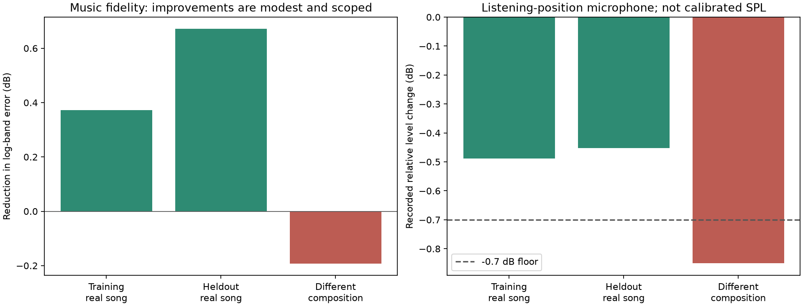
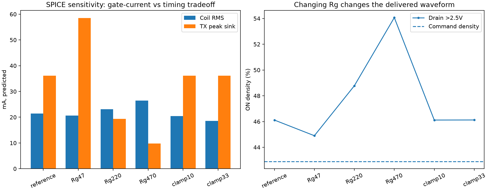

# 歌曲表现联合优化：电路、仿真与预失真（1.2）

本轮已实际运行电路敏感度仿真、歌曲录放、预失真扫描、独立片段验证和不同乐曲验证。全局默认保留1.1.1编码及响度设置，新增有界预失真开关和实验电路边沿编码。没有物理修改电路。

## 可复核的音乐结果

训练使用真实歌曲45–53秒；冻结候选后验证76–84秒。另以不同多声部原创乐曲检查迁移。评价包含频谱平衡、随时间变化的频谱一致性、录音电平下限及首尾重复基线，不以单音THD调参。

| 数据 | 频谱平衡误差改善 | 录音电平变化 | 结论 |
|---|---:|---:|---|
| Real song: training | +0.372 dB | -0.489 dB | 局部通过 |
| Real song: heldout | +0.672 dB | -0.452 dB | 局部通过 |
| Different composition | -0.193 dB | -0.850 dB | 未通过，禁止设为通用默认 |

这些是当前麦克风位置的相对指标，不是绝对声压或听感评分。不同乐曲首次录音出现较大瞬态及基线漂移，已保留但判无效；表内使用重复后的记录。

## 实装算法

二阶特征在4倍采样率产生并带限，经过257抽头的短记忆FIR后加入主音频；不识别音符、不锁定某一个正弦频率。校正RMS限制为主信号的25%，峰值限制约0.985。100%音量的候选按整段音乐实测筛选；未宣称辨识出了精确磁力或位移非线性。

实时音量v使用 `主信号*v + 二阶校正*v²`，导出串口文件和同步录音参考也采用同一规则。这样在减小音量时会同时收小二阶补偿。

界面新增“歌曲预失真候选 · 可比较”，全局默认关闭。当前这首歌可以手动开关作同曲比较，换WAV后自动关闭。`config/music_dpd_real_song_v120.json` 是显式启用的局部候选。

正负极性/两档幅度的正式辨识尝试，因相位稳定性和有效相关性未达门槛而被拒绝，未用该拟合结果驱动默认配置。原始录音、对齐诊断和拒绝状态均在 identification/ 中。

## 电路仿真发现

用户确认：CJ3401高边、5V、55Ω限流、Rg100Ω、Rgs10kΩ、1Ω采样处在续流回路内。M2来自100mV小信号阻抗数据。TX输出33Ω及CJ3401动态模型仍是待校准假设；不能由麦克风推断线圈电流。

| 情形 | 线圈RMS预测 | TX灌流峰值预测 | 漏极ON密度预测 |
|---|---:|---:|---:|
| reference | 21.43 mA | 36.13 mA | 46.12% |
| Rg47 | 20.67 mA | 58.54 mA | 44.90% |
| Rg220 | 23.10 mA | 19.35 mA | 48.78% |
| Rg470 | 26.42 mA | 9.84 mA | 54.07% |
| clamp10 | 20.45 mA | 36.12 mA | 46.12% |
| clamp33 | 18.52 mA | 36.10 mA | 46.12% |

同一段音乐的命令密度约42.90%。Rg470Ω虽减小模型中的栅极峰值负载，却使漏极ON密度约54.07%，因此其电流变大不能当成更好的音频线性。串联续流钳位电阻的预测电流及电压也有变化，本轮没有将其作为实装改动。

从该暂定模型提取的开通/关断中位延迟约40ns/225ns，已实现为 `edge_feedback_uart_v1`，按预计实际交付面积积分误差，而非只数理想位。其简化模型测试通过，但真实歌曲实测没有稳定超过基线波动，因此保留为实验编码器，默认仍使用原逐位反馈。

## 下一步电气校准

优先同步导出TX、G、D及1Ω采样的原始波形，核对TX加载电压、栅极充放电、实际导通面积及全周期电流；在这些波形上校准TX输出阻抗和MOS动态模型，才能进一步评价低输入电容缓冲驱动或钳位改动。当前模型不构成实际引脚峰值电流或温升认证。

## 数据与方法来源

`results/music_dpd_v120/validation.json` 汇总仿真、实测、拒绝原因和默认配置；各目录保留WAV、UART字节与SPICE网表。测试日志为 `results/dpd_tests_final.log`。

预失真需要同时处理时延、记忆与稳定性，方法参考：[Klippel, Active Compensation of Transducer Nonlinearities](https://www.klippel.de/fileadmin/klippel/Files/Know_How/Literature/Papers/Active_Compensation_of_Transducer_Nonlinearities_03.pdf)。这里没有把传统扬声器物理参数直接套到这只电磁蜂鸣器上。
